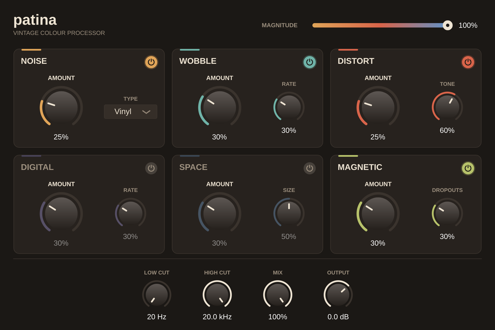

# Patina

A lo-fi "vintage colour" audio effect (VST3 / AU / Standalone) built with JUCE.
Six stackable stages, each with its own power switch, plus a global **Magnitude**
control that scales everything at once.



| Stage | What it does | Extra control |
|---|---|---|
| **Noise** | Adds a noise floor: tape hiss, vinyl crackle + rumble, or 60 Hz hum | Type (Hiss / Vinyl / Hum) |
| **Wobble** | Wow, flutter and random drift via a modulated delay (pitch wobble) | Rate |
| **Distort** | Asymmetric tanh drive with even + odd harmonics, then a tone filter | Tone |
| **Digital** | Bit-depth reduction (16 down to 4 bits) and sample-rate reduction | Rate |
| **Space** | A darkened reverb | Size |
| **Magnetic** | Tape-style level dropouts that dull the top end, plus tape saturation | Dropouts |

Master strip: Low Cut, High Cut, Mix (dry/wet), Output.

Signal flow: `Wobble -> Magnetic -> Distort -> Digital -> Low/High Cut -> Space -> + Noise -> Mix -> Output`

The plugin reports 6 ms of latency (the wobble delay's centre point) so your DAW
keeps it in time, and the dry path is delayed to match so the Mix knob never combs.

## Getting a build

**Easiest:** every push runs GitHub Actions (`.github/workflows/build.yml`) on
macOS, Windows and Linux. Open the latest run under the **Actions** tab and download
the `Patina-macOS` or `Patina-Windows` artifact.

Install the VST3 by copying `Patina.vst3` to:

- macOS: `~/Library/Audio/Plug-Ins/VST3/` (AU: `~/Library/Audio/Plug-Ins/Components/`)
- Windows: `C:\Program Files\Common Files\VST3\`

> macOS builds from CI are unsigned. If your DAW refuses to load it, run
> `xattr -dr com.apple.quarantine ~/Library/Audio/Plug-Ins/VST3/Patina.vst3`.

## Building yourself

Needs CMake 3.22+ and a C++17 compiler (Xcode on macOS, Visual Studio 2022 on Windows).
JUCE is downloaded automatically.

```sh
cmake -B build -DCMAKE_BUILD_TYPE=Release
cmake --build build --config Release
```

Outputs land in `build/Patina_artefacts/Release/`.

### Offline smoke test

```sh
cmake -B build -DPATINA_BUILD_TESTS=ON
cmake --build build --target PatinaSmokeTest
./build/PatinaSmokeTest_artefacts/Release/PatinaSmokeTest /some/output/dir
```

It runs every stage with odd block sizes, checks for NaNs / runaway levels, confirms
Magnitude 0 is a bit-exact delayed copy of the input, writes before/after WAVs, and
renders a screenshot of the UI.

## Ideas for next steps

- 2x oversampling around Distort to cut aliasing at high drive
- Presets / A-B compare
- Per-stage "flux" (random modulation of each stage's amount)
- Stereo wobble spread
