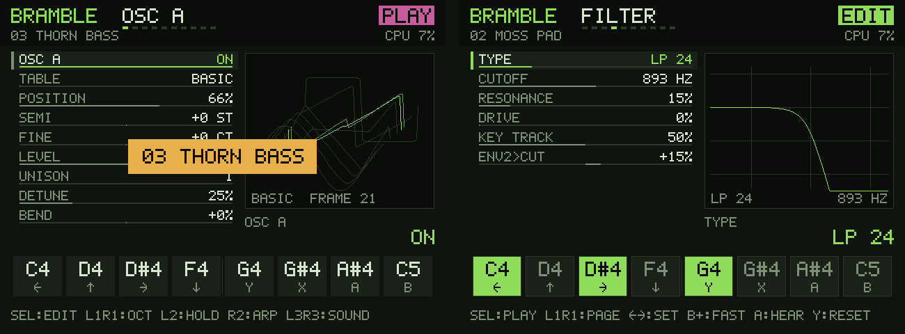

# Bramble

A wavetable synth for the **R36S** handheld (and other RK3326 handhelds running ArkOS, dArkOS/dArkOSRE or a PortMaster-compatible firmware). It's an original instrument in the spirit of the community firmwares for the M-VAVE FM-1: you play it with the handheld's buttons and sticks.



## What's in it

- **2 wavetable oscillators**, 8 built-in tables (Basic, Pulse, Vowel, Organ, Sync, Fold, Metal, Grit), 32 frames each, band-limited per octave. Position, semi/fine, up to 4x unison with detune and stereo spread, and phase bend.
- **Sub oscillator** (sine, triangle, square; 1 or 2 octaves down) and **noise** with tone.
- **Filter**: LP 12, LP 24, band, HP and notch, with resonance, drive, key tracking and envelope amount.
- **2 envelopes** (amp + ENV2 for the filter and wavetable position), **LFO** with 5 shapes and 6 destinations.
- **Poly (8 voices) or mono** with glide.
- **Chorus, ping-pong delay, reverb.**
- **Play tools**: 7 scales, root, octave, chords (triad, seventh, fifth), hold, and an arpeggiator (up, down, up-down, random).
- **32 preset slots** saved as plain text, 10 factory sounds.

## Controls

| | PLAY mode | EDIT mode |
|---|---|---|
| D-pad | notes 1-4 | choose / change setting |
| Y X A B | notes 5-8 | Y reset, A hear note, X hear chord, hold B for big steps |
| L1 / R1 | octave down / up | page back / forward |
| L2 | hold | hold |
| R2 | arpeggiator on/off | |
| L3 / R3 | previous / next sound | previous / next sound |
| Left stick | wavetable position, vibrato (up) | sweep the selected setting |
| Right stick | pitch bend, filter cutoff | pitch bend, filter cutoff |

**SELECT** switches between PLAY and EDIT. **START** opens the sounds page (A loads, X twice saves). **START + SELECT** quits.

The **INPUT TEST** page (press L1 from the first page) shows exactly what each button and stick reports. If a button is wrong on your unit, fix it in `bramble.cfg`.

## Install on the R36S

1. Download `Bramble.zip` from the latest GitHub Actions run (or build it, below).
2. Copy `ports/Bramble.sh` and the `ports/bramble/` folder into the `ports` folder on your games SD card (`/roms/ports`, or `/roms2/ports` on two-card setups).
3. Restart EmulationStation (or the handheld). Bramble shows up under **Ports**.

It uses the SDL2 that the firmware already has. If the PortMaster folder is there, the launcher picks up its gamepad layout automatically.

## Build

```sh
make            # desktop build (needs libsdl2-dev), keyboard: arrows, z x a s, q w, 1 2 3 4, Enter, Backspace
make test       # renders every factory sound to build/out/*.wav and checks levels and CPU
tools/ui_test.sh  # drives the app with scripted button presses
make r36        # aarch64 build with a cross compiler (gcc-aarch64-linux-gnu), needs glibc 2.34+ on the device
make package    # dist/Bramble.zip
```

The CI workflow builds the release binary inside a Debian 10 arm64 container, so it only needs glibc 2.28 and runs on older ArkOS images too.

## Status

Built and tested on Linux (desktop build, headless UI tests, and the engine running as aarch64 under qemu). **It hasn't been run on a real R36S yet.** The likely rough edges are the button layout on some clones (use the INPUT TEST page and `bramble.cfg`) and CPU headroom in extreme patches: 8 voices with 4x unison on both oscillators is the heaviest case.

## License

Original code. No code, wavetables or artwork from other synths or firmwares.
